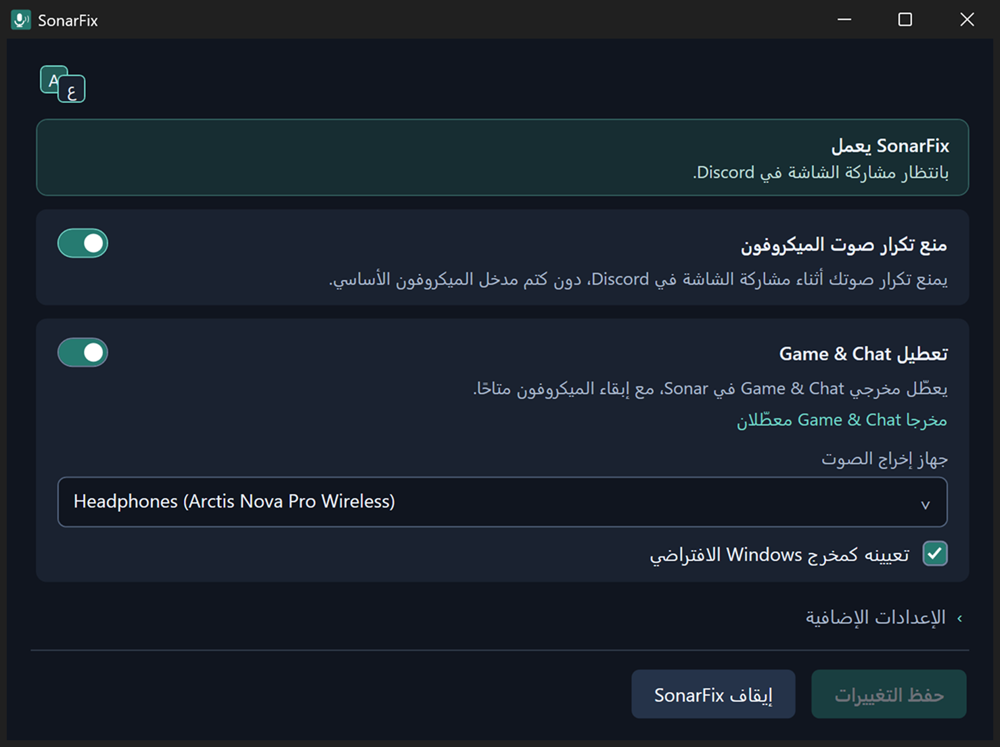
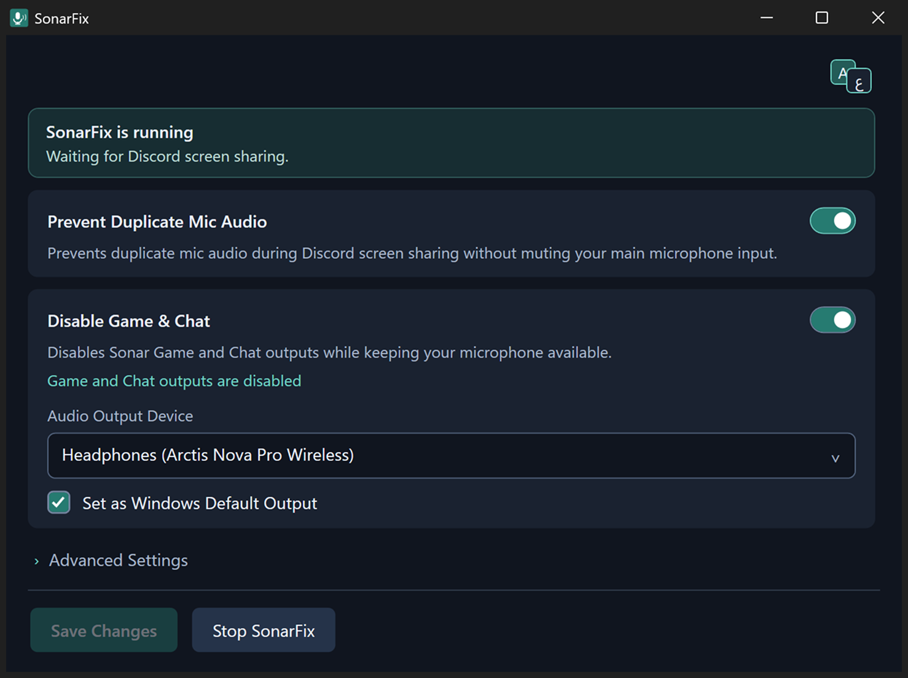

  

<h1 align="center">SonarFix</h1>

  أداة خفيفة لنظام Windows تمنع تكرار صوت الميكروفون في Discord، وتتيح لك تعطيل أجهزة الصوت التي لا تحتاجها في SteelSeries Sonar.

  
  
  

  <a href="README.md">English</a> · <b>العربية</b>

> SonarFix مشروع مجتمعي مستقل وغير رسمي، ولا يتبع SteelSeries أو Discord، ولا تدعمه أو ترعاه أيٌّ منهما.

## الميزات

- **منع تكرار صوت الميكروفون في Discord:** يكتم التشغيل المكرر من Discord وحده أثناء مشاركة الشاشة، ولا يكتم الميكروفون أبدًا.
- **تعطيل Game & Chat في Sonar:** يعطّل مخارج Sonar التي لا تحتاجها ويُبقيها معطّلة.
- **استعادة الصوت وفحص الأجهزة:** تراجع عن كل ما غيّره SonarFix، واعرف حالة أجهزة Sonar بنظرة واحدة.

وأيضًا: العربية والإنجليزية، وأيقونة اختيارية في شريط النظام، والتشغيل مع Windows، والتحقق من التحديثات. القائمة الكاملة في [دليل الاستخدام](docs/user-guide.ar.md).

## صور البرنامج

### العربية

  

### الإنجليزية

  

## التنزيل

**[نزّل أحدث إصدار](https://github.com/tuxp1/SonarFix/releases/latest)** (`SonarFix-Setup-x.y.exe`).

**المتطلبات:** Windows 10 أو 11 بنظام 64 بت، و‏.NET Framework 4.8 (موجود في Windows)، وSteelSeries GG مع Sonar، وDiscord لميزة منع تكرار الصوت.

**التثبيت:** شغّل المثبّت (لا يحتاج صلاحيات المسؤول)، واختر الميزات، وإن عطّلت Game & Chat فاختر جهاز الإخراج الذي تسمع منه. إذا كان البرنامج مثبّتًا من قبل فسيعرض المثبّت: تحديث أو تعديل أو إزالة.

> [!NOTE]
> المثبّت غير موقّع رقميًا بعد، لذلك قد يظهر تحذير SmartScreen في أول تشغيل. كل إصدار يذكر بصمة SHA-256 للمثبّت لتتأكد من سلامته. جُرّب SonarFix مع إعداد سماعة SteelSeries واحد على Windows 11، راجع [القيود المعروفة](docs/user-guide.ar.md#القيود-المعروفة).

## التوثيق

- [دليل الاستخدام](docs/user-guide.ar.md): كل الميزات والتثبيت والإزالة والقيود المعروفة
- [كيف يعمل](docs/how-it-works.ar.md)
- [حل المشكلات](docs/troubleshooting.ar.md)
- [البناء من الكود المصدري](docs/building.md) (بالإنجليزية)

## المساهمة

نرحّب ببلاغات الأخطاء والترجمات وطلبات الدمج. اقرأ [CONTRIBUTING.md](CONTRIBUTING.md) أولًا، وللإبلاغ عن ثغرة أمنية اتبع [SECURITY.md](SECURITY.md).

## الترخيص

SonarFix منشور برخصة [MIT](LICENSE). المكونات الخارجية تحتفظ برخصها الخاصة، راجع [THIRD_PARTY_NOTICES.md](THIRD_PARTY_NOTICES.md) ومجلد [LICENSES](LICENSES).

SteelSeries وSonar وSteelSeries GG وDiscord علامات تجارية لأصحابها، وتُذكر هنا فقط لتوضيح التوافق.

